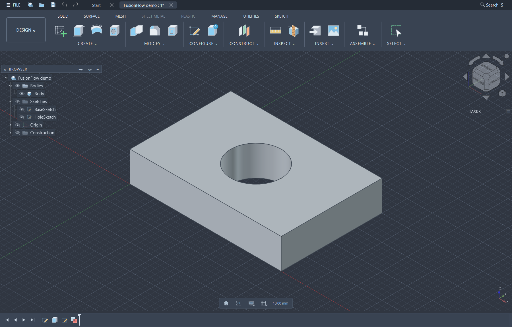

# FusionFlow for FreeCAD

**A Fusion-inspired modelling environment built on FreeCAD's Part Design and Sketcher.**
FusionFlow brings a grouped ribbon, an overlay browser, a compact feature timeline,
profile and face extrusion, construction geometry and inspection tools to FreeCAD.

[**Download the add-on ZIP**](https://github.com/Jirkas-prog/freecad-fusion/releases/latest/download/FusionFlow-addon.zip)
· [Release notes](https://github.com/Jirkas-prog/freecad-fusion/releases)
· [Český návod](docs/README.cs.md)
· [Report an issue](https://github.com/Jirkas-prog/freecad-fusion/issues)



This is an independent add-on, **not a replacement FreeCAD build**. It leaves the
FreeCAD executable and modelling kernel unchanged. It recreates familiar workflows;
it does not promise complete Autodesk Fusion feature parity or F3D compatibility.

## Compatibility

| Component | Tested configuration |
| --- | --- |
| FreeCAD | **1.1.3**, official Windows x86-64 build |
| Python bundled with FreeCAD | 3.11.14 |
| Qt / Python bindings | Qt 6.8.3, PySide6 |
| Operating system | Windows 11, 64-bit |
| Main workbenches | Part Design and Sketcher |
| FusionFlow | 0.20.0, first public distribution |

FreeCAD 0.21, 1.0, Qt 5 builds, development builds and other operating systems have
not been validated. Some helpers use FreeCAD 1.1 APIs and PySide6 directly, so a
successful import on another version does not establish compatibility.

## Install

1. Install [FreeCAD 1.1.3](https://github.com/FreeCAD/FreeCAD/releases/tag/1.1.3).
2. Download the add-on ZIP above and **extract the entire archive**.
3. Save your work and close FreeCAD. Double-click **`Install.cmd`** in the extracted folder.
4. Start FreeCAD. The ribbon, browser and navigation activate automatically.
   Restart once more after that first launch for the complete OpenDark theme.

No administrator access, separate Python installation or Autodesk installation is
required. The package includes the two dependencies: our modified `freecad-fusion`
navigation add-on and OpenTheme. The installer uses the standard FreeCAD 1.1 profile
at `%APPDATA%\FreeCAD\v1-1`, backs up existing copies and configuration files to
`FusionFlow-backups/<timestamp>`, and copies only add-ons. It does not download software.

For a custom profile, run:

```powershell
powershell -NoProfile -ExecutionPolicy Bypass -File .\tools\Install.ps1 -Profile 'D:\CAD-profile'
```

For manual installation, find your actual profile with `App.getUserAppDataDir()` in
FreeCAD's Python console. Copy these folders as siblings inside its `Mod` directory:

```text
Mod/
├── FusionFlow/       ← FusionFlow/ from this download
├── freecad-fusion/   ← vendor/freecad-fusion/
└── OpenTheme/        ← vendor/OpenTheme/
```

Do not copy the repository itself as one workbench folder. Direct Addon Manager
installation of this repository is not currently supported.

## What it adds

| Area | Implemented behaviour |
| --- | --- |
| Workspace | Grouped Solid/Sketch ribbon with dropdowns, document tabs at the top, larger controls, dark styling and an adaptive workspace grid. |
| Browser | Overlay presentation, grouped Bodies / Sketches / Origin / Construction, visibility controls, selection and dependency diagnostics; browser modes can be switched. |
| Timeline | Small feature icons at the bottom with tooltips, selection, editing and navigation through modelling history. Uses the document's feature/dependency structure. |
| Sketching | Sketch palette, grid and visibility options, profile shading, construction/projected geometry, dimensions and native Sketcher tools. |
| Extrude | Selected sketch regions or a planar solid face; New Body, Join, Cut and Intersect; signed distance, two sides, symmetric extent, taper, To Object and Through All; interactive handles and preview. |
| Multi-body Cut | Objects To Cut list with per-body checkboxes, preserving exclusions when editing; linked cut history across affected bodies. |
| Combine | Explicit target and tool bodies; Join / Cut / Intersect, with an option to keep tools. |
| Construct | Offset and angled planes, midplanes, tangent and path planes, reference axes, points and coordinate systems. References update with supported source changes. |
| Inspect | Saved section analysis with caps/hatching, measurements, interference, centre of mass and surface-analysis tools. |
| Navigation | Fusion-style mouse navigation, keyboard shortcuts and cursor-anchored dragging of the navigation cube. |
| Icons | 102 original scalable SVG drawings, consistently used in the ribbon, browser and timeline. |

## A quick modelling workflow

1. Create a document and choose **Create Sketch**. Selecting a planar face first
   creates the sketch on that face.
2. Draw closed regions and finish the sketch. A single sketch can supply several operations.
3. Select a region or a planar solid face and press **E**. Choose the operation and extent.
4. For **Cut**, expand **Objects To Cut** and uncheck any body that must be preserved.
5. Use **Construct → Offset Plane** for a new sketch plane, or **Inspect → Section Analysis**
   to inspect the interior without changing the solid.
6. Select a timeline icon to inspect the feature; double-click to edit it.

Useful shortcuts: **E** Extrude, **S** command search, **L** polyline, **R** rectangle,
**C** circle, **D** dimension, **X** construction geometry, **T** trim, **O** offset,
**P** projection, **M** move, **I** measure. Availability depends on the active workbench
and selection. Middle-drag pans; Shift + middle-drag orbits.

## Important limits

- **Join and Intersect use one explicit target body.** For combining multiple bodies,
  use Combine. The multi-body checkbox workflow applies to Cut.
- Auto operation selection uses geometric tests; it is not guaranteed to choose the
  same operation as Fusion. The operation can always be selected explicitly.
- Face extrusion requires a supported planar face. This is not a general push/pull
  editor for arbitrary curved surfaces.
- The timeline is derived from FreeCAD features, not a universal recording of every
  action. It cannot reconstruct deleted modelling information from a flat imported solid.
- Surface inspection is intended for interactive modelling. Some displays use sampled
  geometry; they are not certified metrology or manufacturing checks.
- Topology changes can invalidate referenced edges or faces. Inspect errors and repair
  affected features instead of assuming a shape that still draws is valid.
- Some user-facing tooltips and messages are in Czech. Full localisation is unfinished.
- Documents containing FusionFlow Python-backed profiles, construction features or
  analyses need this add-on to restore and recompute those features. Use STEP for a
  geometry-only handoff; STEP does not preserve parametric history.

## Updates and removal

Keep a copy of working documents before updating FreeCAD or the add-on. Updates
within FreeCAD can change Python bindings, selection handling or internal widget
structure. **Only the configuration listed above is currently verified.** Try a new
FreeCAD release with a separate profile before migrating your working installation.

To remove FusionFlow, close FreeCAD and move the three add-on folders out of `Mod`.
If OpenTheme or `freecad-fusion` was already installed independently, restore its
backed-up copy instead. To restore the exact previous preferences, copy the backed-up
`user.cfg`/`system.cfg` back while FreeCAD is closed. This also reverts later preferences;
keep a copy of your current configuration first. The upstream navigation add-on's
“Restore my previous FreeCAD settings” command only restores its own navigation preset.

## Source layout and development

```text
FusionFlow/             Main Python add-on, icons, package metadata and geometry tests
vendor/freecad-fusion/  MIT navigation add-on with our NaviCube changes
vendor/OpenTheme/       Theme source and preference packs
tools/                 Installer, icon builder, test and release tools
tests/                 Isolated GUI smoke test
docs/                  Czech guide, screenshot and verification notes
LICENSE, NOTICE.md     Project licence and third-party attribution
```

Geometry lives in `fusionflow_core`, `fusionflow_profiles`, `fusionflow_construct`
and `fusionflow_analysis`. The corresponding UI/view modules provide task panels,
interaction and rendering. `fusionflow_ribbon`, `fusionflow_browser` and
`fusionflow_ui` compose the workspace and timeline.

Run the regressions with **FreeCAD's own Python**, not an unrelated system interpreter:

```powershell
& 'C:\Program Files\FreeCAD 1.1\bin\python.exe' tools/run_tests.py
powershell -NoProfile -File tools/test_gui.ps1 -FreeCAD 'C:\Program Files\FreeCAD 1.1\bin\FreeCAD.exe'
```

The GUI test creates a separate temporary profile and a synthetic model. It does not
use personal documents. See [verification notes](docs/VERIFICATION.md) for the scope.
For bug reports, include the versions from **Help → About**, exact reproduction steps
and a minimal non-sensitive model if possible. Do not attach your full user profile.

## Licence

FusionFlow and its original artwork are **LGPL-2.1-or-later**. The navigation dependency
is MIT; OpenTheme is LGPL-2.1-or-later. See [NOTICE.md](NOTICE.md) for attribution.
No Autodesk icon pack, personal CAD models, user configuration or credentials are distributed.
